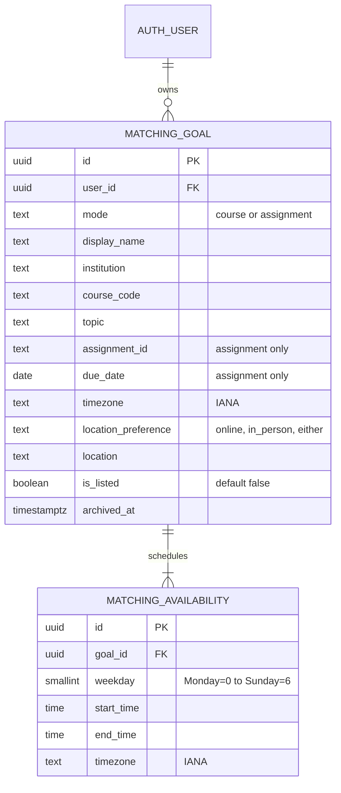
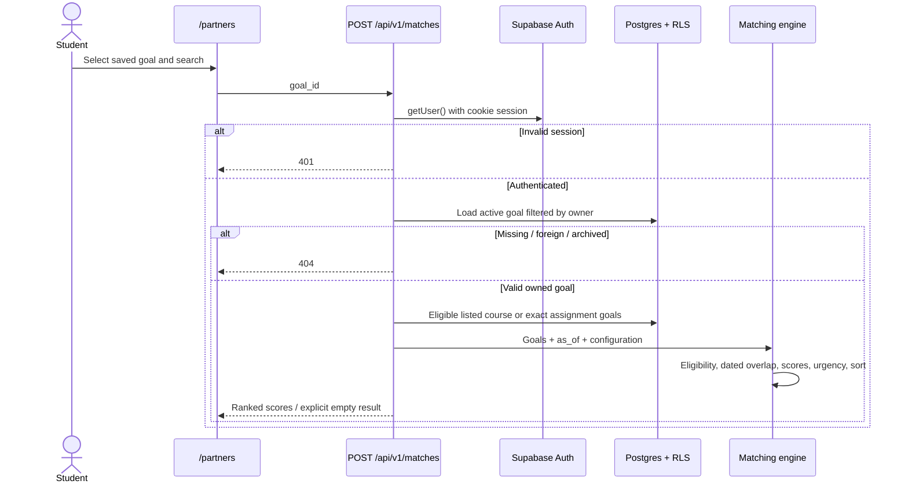

# US-04 / US-05 implementation design

Status: implemented locally. Team urgency agreement, live two-account acceptance review and teammate PR review remain required before Done.

## Scope and traceability

| Story | Accepted story text                                                                                                                                                                                                                | Implementation                                                                         |
| ----- | ---------------------------------------------------------------------------------------------------------------------------------------------------------------------------------------------------------------------------------- | -------------------------------------------------------------------------------------- |
| US-04 | As a Course Study Partner, I want to see students studying the same course topic during my available time, so that I can arrange a focused study session.                                                                          | `/partners`, `lib/matching/engine.ts`, `lib/matching/http.ts`; matching and HTTP tests |
| US-05 | As a Course Study Partner, I want to find students working on the same assignment and see eligible candidates ranked using compatibility and deadline urgency, so that I can arrange a relevant study session before the deadline. | Same components; exact eligibility and base × urgency assertions                       |

US-04 AC1: same course/topic and positive availability overlap, descending scores, displayed total and topic/availability/location components. AC2: empty results display “No suitable match was found.” with no unrelated candidates.

US-05 AC1–2: course and exact assignment ID gate precedes scoring. Different course/assignment is excluded regardless of other scores. AC3: show base score, configured urgency and multiplied final score; automated coverage includes 80 × 1.2 = 96. Invalid/past deadlines return 422. Additional scheduling rule: positive overlap before both assignment deadlines is required.

## Data design and changes from Sprint 2



Both tables include created_at/updated_at. Exact types, length limits, foreign keys, mode-dependent CHECKs, indexes, valid zones, same-day time checks and slot uniqueness are in the migration. Goal-plus-slot creation is atomic through a SECURITY INVOKER function. Invalid slots roll back the goal. RLS allows authenticated peers to read only explicitly listed, unarchived goals/slots, while owners can also read their private goals. Only owners can write, and ownership cannot be reassigned. Removing a goal archives it and withdraws listing.

### Decisions and consequences

1. **Next route handlers instead of Express:** reuse the existing team's Next.js session/cookie application. Avoid a second server; frontend/backend deployment remains coupled. This is a Sprint 2 architecture change.
2. **Additive matching tables:** existing profiles/user_courses/availability/match_scores lack per-goal topic, assignment/deadline and timezone. New tables leave those team tables intact. Later consolidation needs a coordinated migration; onboarding courses are not automatically listed.
3. **Auth identity reference:** user_id references auth.users rather than creating another Student table. A separate user-supplied public matching name avoids reading emails or authentication metadata. It is not a verified identity.
4. **Structural ER and behavioral sequence views:** these describe the schema and matching flow directly. A class diagram would repeat the types; computed match results have no persisted lifecycle requiring a state machine.
5. **Privacy NFR:** listing defaults false with explicit UI consent; owner checks plus database RLS protect writes. This costs an additional listing step and permission tests.
6. **No persisted scores:** compute results at a fixed as_of instant to avoid stale rankings. This costs repeated computation. US-08 result-token/request rechecks, exam prep and language/skill matching remain future work.

## Matching rules

- Institution/course/topic use trim, collapsed whitespace and lowercase. Matching institution also prevents course-code collisions across universities. Assignment IDs trim surrounding whitespace but remain **case-sensitive**, with no fuzzy matching.
- Course mode requires same institution/course/topic. Assignment mode requires same institution/course/exact assignment ID. Exclude self, archived/private candidates and different modes before scoring. The searcher's own goal can be private.
- Expand weekly local slots over the next 14 × 24 hours using IANA timezones. Merge overlapping intervals before counting minutes. Skip ambiguous/nonexistent DST occurrences instead of shifting a student's schedule. Due date means the start of the next day in the goal's timezone; both deadlines clip shared availability.
- Topic score: exact normalized topic 100, otherwise 0 (assignment candidates may use different topic labels). Availability score: overlapping duration / searcher's available duration ×100. Location: compatible online, identical normalized in-person location, or either preference →100; incompatible preferences/places →0. Location affects rank, not eligibility.
- Sprint 2 weights: **topic 0.40, availability 0.35, location 0.25**. Sum unrounded weighted components; round base to two decimals.
- **Urgency proposal awaiting team approval:** candidate's deadline ≤2 calendar days away →1.2; ≤7 →1.1; otherwise →1.0. Course mode uses 1.0. Calendar days use the candidate's goal timezone. Rules are configurable through `DEFAULT_CONFIG` / the `rankCandidates` configuration argument in `engine.ts`; increment configuration version when changing rules. Invalid configurations fail validation.
- Final score = rounded base × multiplier, rounded to two decimals; can exceed 100. Sort descending final score, then candidate goal ID. Keep each student's highest-ranked goal. Display component scores, weights, base, multiplier, total and overlap. Component rounding can cause a displayed 0.01 difference from weighted contributions.
- Capacity: 999 eligible goals. Fetch 1,000 and return 422 if the supported limit is exceeded, avoiding a silently incomplete ranking with the default Supabase 1,000-row cap. A lower project row cap requires lowering both application values. Free-text institution/topic requires consistent spelling until a catalog UI is added.

## Interfaces

All responses use `Cache-Control: private, no-store`. Server `getUser()` verifies the session. Common errors: 401 unauthenticated; 422 invalid JSON/input; 503 unavailable/missing database setup. Missing, foreign and archived search goals return indistinguishable 404. No service-role key is required.

| Endpoint                      | Input            | Output and specific errors                                                                                               | Stories      |
| ----------------------------- | ---------------- | ------------------------------------------------------------------------------------------------------------------------ | ------------ |
| GET /api/v1/matching-goals    | No body          | 200 `{goals: Goal[]}` owned active goals, with slots                                                                     | US-04, US-05 |
| POST /api/v1/matching-goals   | GoalInput below  | 201 `{id:UUID}`; invalid input 422; atomic RPC                                                                           | US-04, US-05 |
| DELETE /api/v1/matching-goals | `{goal_id:UUID}` | 200 `{id,archived:true}`; nonowned/missing 404                                                                           | US-04, US-05 |
| POST /api/v1/matches          | `{goal_id:UUID}` | 200 `{matches,message,as_of,search_horizon_days:14}`; foreign/missing/archived 404; expired/invalid goal or capacity 422 | US-04, US-05 |

GoalInput example; course mode uses null assignment_id and due_date:

```json
{
  "mode": "assignment",
  "display_name": "Demo Student",
  "institution": "NYU",
  "course_code": "CS546",
  "topic": "React",
  "assignment_id": "HW-01",
  "due_date": "2099-11-03",
  "timezone": "America/New_York",
  "location_preference": "online",
  "location": "",
  "is_listed": false,
  "availability": [
    {
      "weekday": 0,
      "start_time": "14:00",
      "end_time": "16:00",
      "timezone": "America/New_York"
    }
  ]
}
```

Each result includes candidate_goal_id, display_name, course/topic/assignment/deadline/location, components, weights, contributions, base_score, urgency_multiplier, final_score, overlap_minutes, overlapping_slots `[{start,end}]` in UTC, and configuration_version. It excludes candidate email, authentication metadata and user ID. The browser displays times in browser timezone. Errors use `{error:string}`; empty results use `matches:[]` and the explicit no-match message.



## Verification and demo

`npm test` covers both stories, timezone/DST and overlap merging, exact assignment exclusion, invalid/past deadlines, score multiplication/order, private/archived goals, ownership, anonymous access, unavailable storage and transactional rollback. HTTP boundary tests use the real Supabase client with stubbed auth/network. Migration/RLS tests execute on embedded PostgreSQL via PGlite. Tests do not write production data.

Manual demo: use two team test accounts in separate browser profiles; visit `/partners`; create listed goals with the same institution/course/topic and overlapping future slots. Search and inspect scores. Add assignment goals with the same ID, then a different ID; only exact IDs match. Remove a goal and confirm it disappears for the peer. Private goals should not appear to peers. No production test users are automatically seeded.

Before Done: approve urgency rules, pass the live two-account demo, obtain teammate PR review, merge to main, and check the deployed build. Local implementation alone does not satisfy the sprint definition of done.

## Verification record — October 31, 2026

21 automated tests passed. ESLint and production build passed. The migration was applied through the authenticated team Supabase Dashboard (the MCP account lacks access). A rolled-back live transaction verified the goal/slot RPC; both tables report RLS enabled. No persistent demo records were created. This manual SQL execution is not recorded in CLI migration history; reconcile it before future CLI deployment.

Live anonymous checks: `/api/v1/matches` returns 401; `/partners` redirects to sign-in; direct Data API reads and RPC invocation also return 401. Security Advisor reported zero errors and six existing warnings concerning `set_updated_at`, `handle_new_user`, `rls_auto_enable` and Auth password protection; none names the new matching tables/functions. Those shared authentication settings were not changed. The browser's saved email/password did not authenticate, and Google requested consent, so the live authenticated two-account demo remains pending user sign-in.
